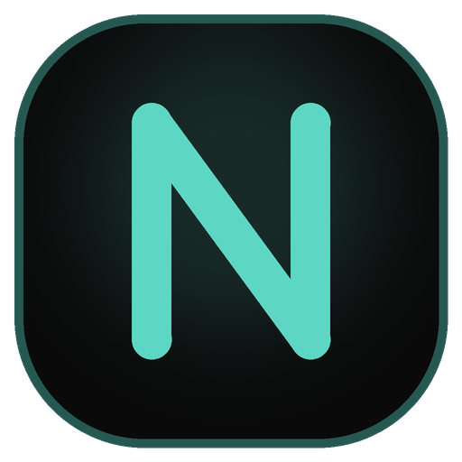

# Nexus

<div align="center">
  
  <p>A lightweight Windows desktop assistant built with Rust and Tauri v2.</p>
</div>

## Features

- **Voice**: Wake-word listener (`Hey Google`, `Jarvis`, `Hey PC`, `Alexa`), corner overlay pill, app launching, media controls, volume mixer, and browser search.
- **Inex Island Integration**: Seamless IPC bridge with Inex Island (`\\.\pipe\inex_island_ipc`) for ambient wake, thinking, and completion status display.
- **Circle to Search**: Screen region capture with offline Windows OCR, translation, Google Lens visual search, and desktop audio music finder.
- **Auto Updates**: Built-in Tauri v2 updater with per-section System and Launch-at-Login controls.

## Build

Prerequisites: [Rust](https://www.rust-lang.org/tools/install) (stable) and Tauri CLI (`cargo install tauri-cli --version "^2.0.0"`).

```bash
git clone https://github.com/inrwxyz/nexus.git
cd nexus
cargo tauri build
```

The Windows NSIS installer is output under `src-tauri/target/release/bundle/nsis/`.

## License

[GPL-3.0](LICENSE)
